<h1 align="center">
  
</h1>

<p align="center">
  
</p>

<h2 align="center">HEY DEAR, I'M ROHAN 👀</h2>

<p align="center">
  
</p>

<p align="center">
  🧡 I'M NOT A PROFESSIONAL CODER, I JUST HAVE SOME KNOWLEDGE OF CODING AND LOVE LEARNING NEW THINGS. 🚀
</p>

---

<h2 align="center">👤 ABOUT ME</h2>

<div align="center">

```text
◆════════════════════◆
║🤩 𝐈ᴅᴇɴᴛɪᴛʏ : 🫧🦋ʀᴏʜ4ɴ 🪐
║•──────────────•
║✅ 𝐔sᴇʀɴᴀᴍᴇ : @rohon_x04 💜
║•──────────────•
║😀 𝐁ᴇsᴛɪ    : 𝐊ᴏɪ ʜᴀ 𝐇ᴇ ɴʜɪ 🤩
║•──────────────•
║💓 𝐀ɢᴇ      : 17 🔪
║•──────────────•
║👁 𝐁ᴀsᴇᴅ ɪɴ : 𝐰𝐛 🌟
║•──────────────•
║🔒 𝐆ᴇɴᴅᴇʀ   : 𝐦𝐚𝐥𝐞 🖤
║•──────────────•
║🐇 𝐑ᴇʟᴀᴛɪᴏɴ : 𝐊ᴏɪ ʜᴀ 𝐇ᴇ ɴʜɪ 💗
◆════════════════════◆
```

➖➖➖💗➖➖

💜 **𝐆ᴏᴀʟ : 𝐄ᴅɪᴛɪɴɢ , 𝐁ᴏᴛ 𝐃ᴇᴘʟᴏʏ** 😎

➖➖➖💗➖➖

😽 **𝐖ʜᴀᴛ 𝐈 𝐃ᴏ** 😽

➥ 𝐁ᴏᴛ 𝐌ᴀᴋɪɴɢ 🤖

➥ 𝐆ᴀᴍɪɴɢ 🎮

</div>

---

<h2 align="center">🎬 MY VIDEO</h2>

<p align="center">
  <video src="https://github.com/rohon-x04/rohon-x04/blob/main/assets/intro.mp4" width="300" controls muted></video>
</p>

---

<h2 align="center">📊 MY GITHUB STATS & INFO</h2>

<p align="center">
  
  
</p>
<p align="center">
  
</p>

<h2 align="center">🏖️ SOME PROGRAMMING TOOLS I HAVE BASIC KNOWLEDGE OF</h2>

<p align="center">
  
</p>

---

<p align="center">
  
</p>

<p align="center">
  <picture>
    <source media="(prefers-color-scheme: dark)" srcset="https://raw.githubusercontent.com/rohon-x04/rohon-x04/output/github-contribution-grid-snake-dark.svg" />
    
  </picture>
</p>

---

<h2 align="center">📫 CONNECT WITH ME</h2>

<p align="center">
  <a href="https://t.me/rohon_x04"></a>
  <a href="mailto:rohonkazi004@gmail.com"></a>
  <br>
  <a href="https://github.com/ezxrohon"></a>
  <a href="https://github.com/rohon-x04"></a>
</p>

---

<h2 align="center">🤝 JOIN US</h2>

<p align="center">
  <a href="https://t.me/apex2network"></a>
</p>

---


